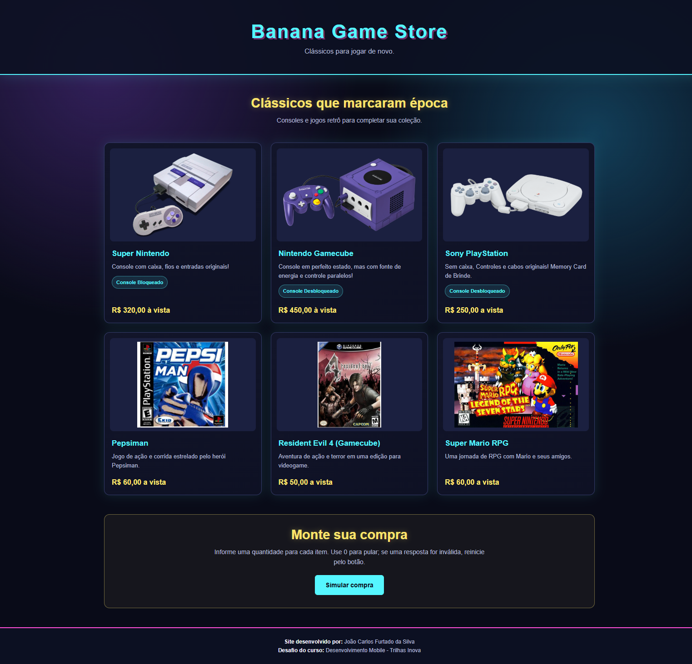

# Banana Game Store

## Identificação

- **Aluno:** João Carlos Furtado da Silva
- **Trilha:** Desenvolvimento Mobile — Trilhas Inova
- **Projeto:** Minha Loja — Simulador de Compras

## Apresentação da loja

A Banana Game Store é uma loja fictícia de consoles e jogos clássicos. A
página apresenta os produtos em cards com imagens, descrições, preços e uma
opção para simular uma compra.

### Produtos e preços

| Produto | Preço |
| --- | ---: |
| Super Nintendo | R$ 320,00 |
| Nintendo Gamecube | R$ 450,00 |
| Sony PlayStation | R$ 250,00 |
| Pepsiman | R$ 60,00 |
| Resident Evil 4 (Gamecube) | R$ 50,00 |
| Super Mario RPG | R$ 60,00 |

## Tecnologias

- **HTML5:** estrutura da página, catálogo e informações da loja.
- **CSS3:** layout responsivo, cards dos produtos, tema arcade e efeitos
  visuais.
- **JavaScript:** validação das respostas, cálculo dos subtotais, resumo e
  total da compra.

## Como executar

Não é necessário instalar dependências. Para executar o projeto:

1. Baixe ou clone este repositório.
2. Abra o arquivo `index.html` em um navegador.
3. Clique em **Simular compra**.
4. Informe a quantidade desejada para cada produto.
5. Use `0` para não incluir um produto na compra.

Respostas vazias, canceladas ou não numéricas encerram a simulação e exibem uma
mensagem de orientação.

## Captura de tela

## Funcionamento da lógica JavaScript

1. Os produtos são armazenados em uma lista com nome e preço.
2. Um laço percorre essa lista e usa `prompt()` para solicitar a quantidade de
   cada item.
3. A função `verificarResposta()` valida a entrada e converte o valor com
   `Number()`.
4. Quantidades iguais a `0` são convertidas para `null`, representando produtos
   não selecionados.
5. `filter()` remove os produtos que não foram selecionados.
6. `reduce()` calcula o total multiplicando preço e quantidade.
7. `map()` monta as linhas do resumo, que são exibidas com `alert()`.
8. Se nenhum produto for selecionado, a página informa essa situação em vez de
   mostrar um resumo vazio.

## Testes realizados

- [x] A página abre e carrega o HTML, o CSS e as imagens do catálogo.
- [x] O botão **Simular compra** inicia a sequência de perguntas.
- [x] Quantidades positivas são calculadas corretamente.
- [x] Uma quantidade `0` remove o produto do resumo.
- [x] Quantidades `0` para todos os produtos exibem a mensagem de nenhum item
      selecionado.
- [x] Respostas vazias, canceladas ou não numéricas encerram a simulação.

## Dificuldade encontrada e aprendizado

- **Dificuldade encontrada:** Preparação do front-end e escolha de design.
- **O que aprendi:** Aprendi a organizar produtos em uma lista e a usar
  funções JavaScript para validar entradas, filtrar itens, calcular valores e
  montar um resumo. Também pratiquei ideias de design com CSS.

## Uso de inteligência artificial

A inteligência artificial foi utilizada como ferramenta de apoio para:

- Esclarecer dúvidas sobre lógica de programação e otimizações.

- Ajudar a definir a ideia do front-end, esclarecendo dúvidas sobre como
  preparar e adaptar um design no código.

- Corrigir a ortografia da documentação e a indentação dos códigos, para que
  ficassem mais legíveis.
